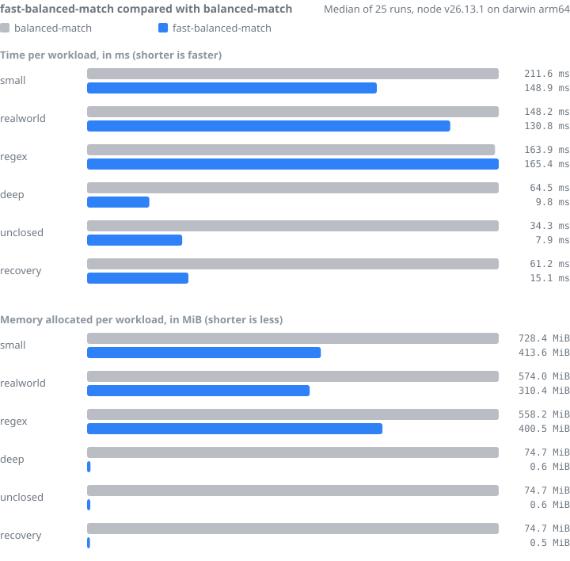

# fast-balanced-match-bench

[](https://github.com/onclick-coop/fast-balanced-match-bench/actions/workflows/release.yaml)

Benchmarks [`@onclick/fast-balanced-match`](https://github.com/onclick-coop/fast-balanced-match) against [`balanced-match`](https://github.com/juliangruber/balanced-match), the package it gives the same results as.



## Run it

Clone this repository beside `fast-balanced-match`, then from this one:

```sh
(cd ../fast-balanced-match && vp install && vp run build)
vp install
vp run bench
vp run chart
```

`vp run bench` checks that both packages give identical answers on every input, then times each one over each workload in a fresh Node process and writes `results.json`.
`vp run chart` draws `results.svg` from it.
`BENCH_RUNS` sets the number of runs, 25 by default.

## Workloads

`src/workload.ts` holds them.

- **small**: the short inputs from `balanced-match`'s own tests, as `pre{in{nest}}post`.
- **realworld**: globs, templates, function calls, markup and JSON of everyday length, as `src/{components,utils,hooks,stores}/**/*.{ts,tsx,vue}`.
- **regex**: regular expression delimiters, as `/\s+\{\s+/` and `/\s+\}\s+/`.
- **deep**: one pair nested ten thousand levels deep.
- **unclosed**: ten thousand openings with a single closing at the end.
- **recovery**: ten thousand openings and nine thousand closings, leaving a thousand unclosed.

## Results

On an Apple M2 with Node 26.13.1, 25 runs each, times in milliseconds and allocations in MiB over the whole timed loop:

| Workload  | Time, `balanced-match` | Time, `fast-balanced-match` | Memory, `balanced-match` | Memory, `fast-balanced-match` |
| --------- | ---------------------- | --------------------------- | ------------------------ | ----------------------------- |
| small     | 211.6 (202.3 to 227.6) | 148.9 (147.6 to 166.3)      | 728.4                    | 413.6                         |
| realworld | 148.2 (146.7 to 165.6) | 130.8 (129.7 to 147.5)      | 574.0                    | 310.4                         |
| regex     | 163.9 (162.3 to 174.2) | 165.4 (164.7 to 178.6)      | 558.2                    | 400.5                         |
| deep      | 64.5 (64.3 to 68.6)    | 9.8 (9.7 to 10.5)           | 74.7                     | 0.6                           |
| unclosed  | 34.3 (34.1 to 36.1)    | 7.9 (7.9 to 8.5)            | 74.7                     | 0.6                           |
| recovery  | 61.2 (60.9 to 67.9)    | 15.1 (15.0 to 16.3)         | 74.7                     | 0.5                           |

Each cell is the median, with the fastest and slowest run in brackets; `results.json` holds every figure.
`fast-balanced-match`'s fastest run beats `balanced-match`'s fastest on every workload but `regex`, where matching the regex itself dominates and the two run within 1%.
Its median is 30% lower on `small` and 12% lower on `realworld`, and 4 to 7 times lower on `deep`, `unclosed` and `recovery`.
It allocates about half as much on everyday input, about three quarters with regex delimiters, and almost nothing on deep or unclosed input.

## Method

- **Same work.** Both packages must give the same answer on every input before anything is timed, and every field of each answer feeds the loop's result, so no part of the work is skipped unread.
- **Fresh processes.** Each run is its own Node process, and the package that runs first alternates by run, so neither always takes a first-run effect.
- **Allocations.** The change in `total_allocated_bytes` from `v8.getHeapStatistics()` over the timed loop barely moves between runs, so it separates the two on a loaded machine where wall time spreads too wide to.
- **Fastest runs and medians.** A speed difference counts only where one package's fastest run beats the other's and its median agrees, since across 25 runs a few slow outliers leave every full range overlapping.

The speed-up came from CPU profiles, each change kept only where a run on a quiet machine showed it faster.

- **No stack.** A profile put about half of `balanced-match`'s time on short input in `range` and another seventh in garbage collection, from the stack array it allocates once a pair is in play, so `fast-balanced-match` counts open delimiters instead.
- **Character codes where delimiters are dense.** Two different single-character delimiters are read one character at a time in short strings and runs of openings, and found by `indexOf` across longer plain text, where reading every character lost.
- **No walk for a contiguous run.** When an opening is never closed and the run before it is contiguous, as in `{{{{`, the paired opening's position is computed rather than found by stepping back through the run.
- **A matcher built once.** `matcher(a, b)` settles how its delimiters are scanned when it is built, so each call only scans.
- **Tried and dropped.** Checking string delimiters inline, a bitwise test for the two delimiters, and integer sentinels in place of `Infinity` each moved no workload past the run-to-run noise.

## Verification

- `fast-balanced-match` passes a port of the [`balanced-match` v5.0.0 tests](https://github.com/juliangruber/balanced-match/blob/v5.0.0/test/test.ts) with the same inputs and expected outputs.
- Its `balanced.oracle.test.ts` checks the matcher against a plain stack-based walk on 400,000 seeded random strings over overlapping and identical delimiter pairs, as `<` and `</`, `aa` and `a`, `ab` and `ba`, and `a` and `a`, so `vp run test` in that repository replays the check.

## License

MIT.
